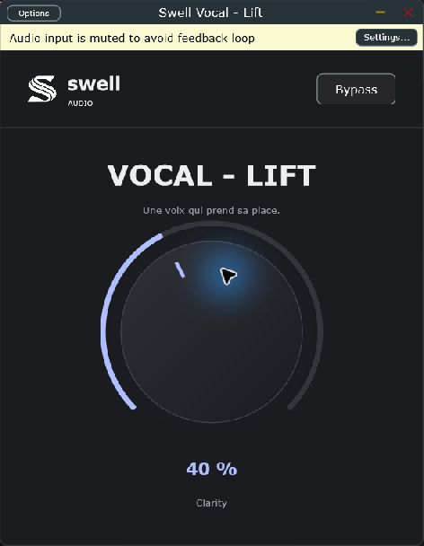

# Swell Vocal - Lift — 0.1.0 prototype

*Capture réelle du Standalone Windows. L’entrée audio est coupée par défaut pour éviter le larsen.*

Un bouton Lift pour faire ressortir une voix : présence, brillance et contrôle
des sifflantes. Le logo S officiel de Swell-audio est intégré.

## Utilisation

Insérer sur la piste de voix et monter Lift progressivement. Commencer vers 25–40 %.
Double-clic : retour à zéro. Bypass : son original, avec latence conservée.
Lift et Bypass sont automatisables et sauvegardés avec le projet du DAW.
La compensation de gain est fixe ; elle n'égalise pas automatiquement le volume perçu.

## Traitement

- Renfort de présence et d'aigus à intensité progressive.
- Détection relative de l'énergie sifflante, liée en stéréo, pour réduire le renfort
  et atténuer la bande aiguë lorsque cette énergie domine.
- Léger retrait du bas et contribution harmonique discrète dans la présence.
- Suréchantillonnage 4x, paramètres lissés, chemin original compensé en latence.
- Aucun lecteur de fichier dans le Standalone : il traite une entrée audio.

Version de travail : la détection des sifflantes est heuristique, pas une séparation
de voix par IA. Elle peut aussi réagir aux cymbales et aux sons riches en aigus.
Valider à l'écoute sur des voix réelles avant distribution. Ce n'est pas un limiteur ;
garder de la marge en entrée et surveiller le niveau de sortie.

## Windows

Copier le dossier complet `Swell Vocal - Lift.vst3` dans
`C:\Program Files\Common Files\VST3`, puis relancer le scan du DAW.
Le Standalone `Swell Vocal - Lift.exe` se lance sans DAW ; choisir son interface
audio dans Options. L'entrée est coupée par défaut pour éviter le larsen.

## Compiler

Windows : Visual Studio 2022 Build Tools C++, CMake et Git ; lancer `build.ps1`.
Mac : Xcode, CMake et Git ; lancer `sh build-mac.sh`.
Sorties : `build/SwellVocalLift_artefacts/Release/`.
Mac configure VST3, AU et Standalone universels Intel/Apple Silicon.
VST2 n'est pas configuré. Les binaires sont non signés.

JUCE 8.0.6 est téléchargé par CMake. JUCE est sous AGPLv3 ou licence commerciale :
choisir la licence adaptée avant distribution.
